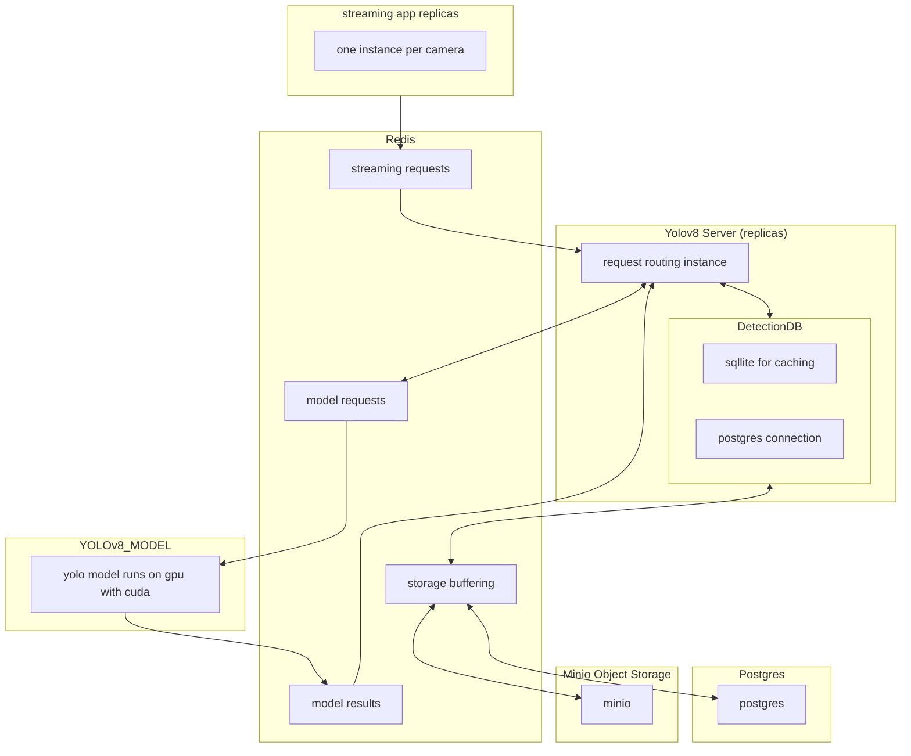

# VISP
**Vision Industrial Support Platform**

## Purpose / Vision
Providing a Platform for real-time video analytics on the edge device. VISP will manage Cameras, Models, Data collection and analytics in order to provide a platform for implementing Industrial Vision Solutions.

### Proposed Example Projects
Platform Platform Platform, but what do I need this for?
- PPE Compliance - are you wearing you hardhat and your high visibility clothes
- Area Access Control - are there personnels here and how many
- Wildlife Monitoring - did a Coyote find a cozy bed in your crusher

Implementing these would showcase what the platform can do for the client. Further use cases can be developed for this client. This will be the vector of developing platform capabilities.

## Timing / Strategic Value - Why Bother?
### Why Edge
Use of the cloud is very popular and has many applications. Edge computing fits industrial projects because they have space, and compared to instrumentation regularly used on site, a linux based edge device is laughable. If a control loop were to use VISP, keeping things on premise is preferred. Detection data could be uploaded to the cloud for advanced diagnostics, or for specialized model training, but otherwise a heartbeat with a summary would be sent up.
### Why Computer Vision
This comes with an assumption that cameras would be everywhere on site. Surprisingly they aren't that common. But they should be everywhere. Besides the obvious security applications, cameras empowered by vision models could give direct process insight (fluid level, feed size, bubble size, ...). It could alert the operator of an event like undesired material on the belt, or frothing pattern change in a flotation cell. Easily missed even when starring at the live video feed.

## VISP Architecture

