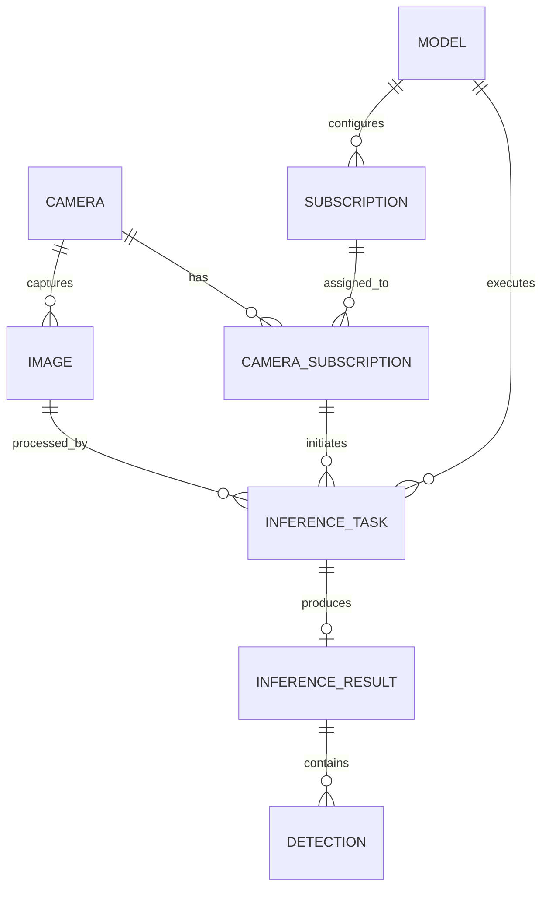

# VISP Software Architecture

## 1. Logical Architecture

VISP consists of six primary components with distinct responsibilities. The architecture separates camera acquisition, platform coordination, inference processing, asynchronous communication, and data storage.

### 1.1. Camera Acquisition

Maintains connections to registered network cameras and acquires video frames.

Responsibilities:
- Maintain connections to registered RTSP cameras.
- Monitor camera connectivity and acquisition status.
- Periodically retrieve camera and subscription configuration from the VISP Server.
- Acquire frames according to the configured acquisition interval.
- Submit acquired frames to the VISP Server for processing.
- Report component health and camera acquisition status through heartbeats.

Camera Acquisition does not determine which inference models or inference engines process a frame.

### 1.2. VISP Server

Coordinates platform operations, manages requests, and provides access to platform services.

Responsibilities:
- Expose interfaces for camera acquisition, applications, administrators, and external clients.
- Manage cameras, subscriptions, and application configurations.
- Receive and validate incoming frames and requests.
- Determine which subscriptions and inference models apply to acquired frames.
- Create and dispatch inference jobs through the Messaging System.
- Manage inference job lifecycles, including submission, completion, failure, and retries.
- Receive and process inference results.
- Coordinate the persistence of inference metadata and associated images.
- Manage component health and operational status.
- Provide access to historical inference data and associated images.

The VISP Server handles orchestration and management operations independently of the computational workload performed by Inference Engines.

### 1.3. Inference Engine

Executes computer vision models and returns inference results.

Responsibilities:
- Receive inference jobs through the Messaging System.
- Load and manage computer vision models.
- Execute inference using available compute resources, including GPU where available.
- Return inference results through the Messaging System.
- Report engine health and processing status.

Inference Engines are independent of the VISP Server and can be scaled separately. They execute inference jobs without needing to understand VISP subscriptions or application-specific business logic.

### 1.4. Messaging System

Facilitates asynchronous communication between the VISP Server and Inference Engines.

Responsibilities:
- Accept inference jobs submitted by the VISP Server.
- Make jobs available to compatible Inference Engines.
- Support asynchronous processing and decouple job submission from execution.
- Return inference results to the VISP Server.
- Retain jobs until an appropriate Inference Engine is available to process them.

The Messaging System transports jobs and results. Decisions about which processing tasks are required remain the responsibility of the VISP Server.

### 1.5. Database

Stores structured platform information and inference metadata.

Responsibilities:
- Store camera registrations and configuration.
- Store subscriptions and camera-subscription associations.
- Store application configurations and related platform metadata.
- Store inference job records and their status.
- Store inference results and detection metadata.
- Maintain current operational status of platform components and cameras.
- Optionally retain operational status history for diagnostics and monitoring.
- Store references to images and other files maintained by File Storage.

### 1.6. File Storage

Stores images and other files associated with inference results.

The initial implementation will use object storage through MinIO.

Responsibilities:
- Store images associated with inference results.
- Organize stored objects using identifiable object keys.
- Provide image retrieval through object references.
- Support image retention and deletion policies.
- Keep image storage independent of the Database.

The Database stores references to stored objects rather than the actual image data or temporary access URLs.

## 2. Component Interaction

### 2.1. Real-time Inference

1. Camera Acquisition periodically retrieves camera and subscription configuration from the VISP Server.
2. Camera Acquisition acquires a frame from a registered camera.
3. The frame is submitted to the VISP Server along with its camera identifier.
4. The VISP Server determines which subscriptions and inference models apply.
5. The VISP Server creates and submits the appropriate inference jobs to the Messaging System.
6. An available Inference Engine consumes the job and executes the required model.
7. The inference result is returned through the Messaging System.
8. The VISP Server processes the result and coordinates its storage and availability to applications.

A single acquired frame may generate multiple inference jobs when multiple subscriptions require different models or processing tasks.

### 2.2. VISP Query

1. A request is submitted to the VISP Server.
2. The VISP Server processes the request and retrieves the required information from the Database and/or File Storage.
3. The VISP Server returns the requested information to the requester.

### 2.3. Image Storage and Retrieval

1. The VISP Server submits an image to File Storage.
2. File Storage stores the image and returns an object reference.
3. The VISP Server stores the object reference and associated metadata in the Database.
4. When an image is requested, the VISP Server retrieves its reference from the Database.
5. The VISP Server uses that reference to retrieve the image from File Storage and makes it available to the requester.

## 3. Data Architecture

### 3.1. Data Organization

VISP data is organized into two logical domains based on the nature and lifecycle of the information they contain.

**Configuration and Registry Data**

This domain contains relatively stable entities that define the platform's registered resources and processing configurations.

- **Camera** – Represents a registered physical camera and its connection information.
- **Model** – Represents a registered computer vision model.
- **Subscription** – Defines how and when a computer vision model is used.
- **CameraSubscription** – Associates a Camera with a Subscription.

These entities may change throughout the platform's lifecycle, but generally represent longer-lived configuration information.

**Operational and Historical Data**

This domain contains chronological records generated during platform operation.

- **Image** – Represents an image acquired from a registered camera.
- **InferenceTask** – Represents a request to process an image using a particular camera subscription.
- **InferenceResult** – Represents the outcome returned from an inference task.
- **Detection** – Represents an individual object identified during inference.

Operational records are generated continuously and are expected to accumulate over time. They will therefore require independent retention, archival, backup and deletion policies.

These are logical data domains. Their separation does not necessarily imply separate databases or database servers.

### 3.2. Configuration and Registry Entities

#### 3.2.1. Camera

Represents a registered physical camera.

Proposed attributes:

- `camera_id` – Primary key.
- `camera_name` – Registered camera name.
- `rtsp_url` – Camera connection address.
- `location` – Physical installation location.
- `status` – Current camera status.

Additional camera configuration may include manufacturer, model, mounting position, orientation, field of view and calibration information.

Camera configuration can change throughout its lifecycle. Cameras should be decommissioned or disabled rather than physically deleted when historical records reference them.

#### 3.2.2. Model

Represents a registered computer vision model.

Proposed attributes:

- `model_id` – Primary key.
- `model_name` – Registered model name.
- `model_reference` – Reference to the model artifact.
- `model_type` – Model classification or task type.
- `version` – Model version.
- `status` – Current model status.

Models may be shared by multiple subscriptions. Model records should be retired or deactivated rather than physically deleted when historical inference tasks reference them.

#### 3.2.3. Subscription

Defines the processing configuration associated with a computer vision model.

Proposed attributes:

- `subscription_id` – Primary key.
- `subscription_name` – Subscription name.
- `model_id` – Foreign key referencing Model.
- `inference_schedule` – Defines when or how frequently inference is performed.
- `saving_policy` – Defines the image and inference data retention or saving behaviour associated with the subscription.
- `status` – Determines whether the processing configuration is available for use.

A Subscription is independent of a particular Camera. This allows the same processing configuration to be reused across multiple cameras.

Subscription records should be deactivated or retired rather than physically deleted when historical records reference them.

#### 3.2.4. CameraSubscription

Associates a Camera with a Subscription.

Proposed attributes:

- `camera_subscription_id` – Primary key.
- `camera_id` – Foreign key referencing Camera.
- `subscription_id` – Foreign key referencing Subscription.
- `status` – Current assignment status. Determines whether that particular camera is actively assigned to the subscription.

A Camera can have multiple subscriptions, and a Subscription can be assigned to multiple cameras.

The combination of `camera_id` and `subscription_id` must be unique.

CameraSubscription represents the specific assignment of a processing configuration to a camera. This relationship is important because an inference task must identify the particular camera-subscription assignment that initiated the processing request.

Assignments should be deactivated or ended rather than physically deleted when historical inference tasks reference them.

### 3.3. Operational and Historical Entities

#### 3.3.1. Image

Represents an image acquired from a registered camera.

Proposed attributes:

- `image_id` – Primary key.
- `image_reference` – Reference to the image stored in file storage (MinIO).
- `camera_id` – Foreign key referencing Camera.
- `camera_snapshot` – JSON snapshot of relevant camera metadata at the time of image capture.
- `captured_at` – Image capture timestamp.

The image is acquired once and can be referenced by multiple inference tasks.

For example, when a camera has multiple active subscriptions, the same acquired image may be processed independently by multiple models or processing configurations. Each resulting inference task references the same Image record.

The camera snapshot preserves historical context, including relevant information such as camera name, physical location, mounting position and orientation.

For cameras with dynamic positioning, such as PTZ cameras, the relevant position and orientation at capture time may also be included. More extensive camera movement history or telemetry can be introduced separately if required.

The Camera foreign key must use `ON DELETE RESTRICT` to prevent deletion of a camera while historical images reference it.

The Image database record and the physical image file are treated separately. The physical file may eventually be archived or deleted according to retention policies while the Image record remains available as historical metadata.

#### 3.3.2. InferenceTask

Represents an individual request to process an image using a particular CameraSubscription.

Proposed attributes:

- `task_id` – Primary key.
- `image_id` – Foreign key referencing Image.
- `camera_subscription_id` – Foreign key referencing CameraSubscription.
- `model_id` – Foreign key referencing Model.
- `subscription_snapshot` – JSON snapshot of the subscription configuration at task creation.
- `model_snapshot` – JSON snapshot of the model metadata at task creation.
- `status` – Current task lifecycle status.
- `submitted_at` – Task submission timestamp.
- `completed_at` – Task completion timestamp.
- `retry_count` – Number of processing attempts.

The task references the CameraSubscription that initiated processing and the Model used for inference.

Although the Model and Subscription are already referenced through the configuration relationships, snapshots are retained on the task to preserve the exact configuration context at the time of processing.

The model and subscription snapshots are captured when the task is created and must not be reconstructed from the current configuration records.

The Model foreign key is retained to support relational queries and maintain referential integrity. The model snapshot independently preserves historical metadata.

The CameraSubscription and Model foreign keys must use `ON DELETE RESTRICT` to prevent deletion of referenced configuration records. The Image foreign key must also protect historical task references.

#### 3.3.3. InferenceResult

Represents the outcome returned by an Inference Engine after processing an InferenceTask.

Proposed attributes:

- `result_id` – Primary key.
- `task_id` – Foreign key referencing InferenceTask.
- `status` – Inference outcome.
- `completed_at` – Inference completion timestamp.
- `processing_duration` – Time taken to execute inference.
- `detection_count` – Number of detections produced.
- `result_metadata` – Optional JSON containing additional inference execution information.

The result status is separate from the task status. Task status tracks the lifecycle of the processing request, while result status describes the outcome returned by the inference engine.

A successful inference can produce zero or more detections. An empty detection collection represents a valid inference result when no objects are identified.

The InferenceResult does not duplicate the model, subscription or camera snapshots. Its associated InferenceTask provides access to the relevant historical context.

An InferenceTask produces at most one final InferenceResult. The task and result records must be retained consistently so that historical results do not become detached from their originating tasks.

Retries, processing delays and other execution details may be recorded in result metadata or dedicated fields as their requirements become clearer.

#### 3.3.4. Detection

Represents an individual object identified during an inference operation.

Proposed attributes:

- `detection_id` – Primary key identifying the detection.
- `result_id` – Foreign key referencing InferenceResult.
- `class_id` – Model-defined class identifier.
- `class_name` – Human-readable object class.
- `confidence` – Confidence score assigned by the model.
- `bounding_box` – Coordinates describing the detected object's location in the image.

Each detection belongs to exactly one InferenceResult. An InferenceResult can have zero or many detections.

Detections are stored as individual database records rather than embedded in a JSON field. This allows detections to be queried independently by class, confidence, camera and time range.

`class_name` is stored alongside `class_id` so historical records remain understandable if a model's class definitions change.

Bounding-box coordinates should use normalized values between 0 and 1, making them independent of the original image resolution.

The image associated with a detection is resolved through its relationships:

`Detection → InferenceResult → InferenceTask → Image`

A separate `image_id` in the Detection table is unnecessary because the image can be determined through these relationships.

The `result_id` foreign key must use `ON DELETE RESTRICT` to protect detections associated with historical inference results.

### 3.4 Entity Relationships

#### 3.4.1 Entity Relationship Diagram



#### 3.4.2. Relationship Descriptions

- `Camera` – `Subscription`: A many-to-many relationship resolved through `CameraSubscription`.
- `Model` – `Subscription`: A model can be referenced by multiple subscriptions.
- `Image` – `InferenceTask`: An acquired image can be processed by multiple inference tasks, allowing multiple subscriptions to process the same frame without duplicating the image.
- `CameraSubscription` – `InferenceTask`: Each task identifies the specific camera-subscription assignment that initiated processing.
- `InferenceTask` – `InferenceResult`: Each task can produce at most one final result.
- `InferenceResult` – `Detection`: Each result can contain zero or more detections.

#### 3.4.3. Relationship Constraints

1. A `CameraSubscription` must reference one existing `Camera` and one existing `Subscription`.
2. A `CameraSubscription` combination of `camera_id` and `subscription_id` must be unique.
3. An `InferenceTask` must reference one existing `Image`, `CameraSubscription` and `Model`.
4. The `Model` referenced by an `InferenceTask` must match the `Model` configured by the `Subscription` associated with its `CameraSubscription` when the task is created.
5. An `InferenceResult` must reference one existing `InferenceTask`.
6. A `Detection` must reference one existing `InferenceResult`.

### 3.5. Data Integrity and Retention

#### 3.5.1. Referential Integrity

VISP must preserve the relationships between configuration entities and historical operational records.

Foreign-key relationships referencing historical records must use `ON DELETE RESTRICT` to prevent the physical deletion of records that are still referenced.

The following relationships must be protected:

- `Camera` → `Image`
- `Image` → `InferenceTask`
- `CameraSubscription` → `InferenceTask`
- `Model` → `InferenceTask`
- `InferenceTask` → `InferenceResult`
- `InferenceResult` → `Detection`

Configuration entities must also retain their relationships while referenced by other configuration records. For example, a `Subscription` must not be physically deleted while a `CameraSubscription` references it.

The database must preserve referential integrity so that historical records cannot become detached from their associated configuration or operational records.

#### 3.5.2. Configuration Lifecycle Management

Configuration entities are intended to be long-lived records and should be deactivated, retired or decommissioned rather than physically deleted.

This applies to:

- `Camera`
- `Model`
- `Subscription`
- `CameraSubscription`

The status of each entity determines its availability for future platform operations.

Subscription status determines whether a processing configuration is available for use, while CameraSubscription status determines whether a particular camera is actively assigned to that subscription.

Deactivating or retiring a configuration entity must not affect historical inference tasks or results that reference it.

Retiring a Subscription must prevent new inference tasks from being generated through its associated camera assignments. Existing CameraSubscription records and historical inference records must remain intact.

#### 3.5.3. Historical Data Preservation

Operational records must preserve the relevant configuration context that existed when the associated operation occurred.

Snapshots are retained to prevent changes to current configuration records from altering the interpretation of historical data.

The following snapshots are maintained:

- `Image.camera_snapshot` – Preserves relevant camera metadata at the time of image capture.
- `InferenceTask.subscription_snapshot` – Preserves the subscription configuration at the time the inference task was created.
- `InferenceTask.model_snapshot` – Preserves model metadata at the time the inference task was created.

Snapshots must be captured when their associated records are created and must not be reconstructed from current configuration records.

Historical records should remain interpretable even when cameras, subscriptions or models are subsequently modified, deactivated or retired.

#### 3.5.4. Data Retention and Archival

VISP must support independent retention policies for operational metadata and the physical files associated with inference operations.

The database records and physical image files are treated separately. An image file stored in MinIO may be archived or deleted while its corresponding Image database record remains available.

Retention policies may apply independently to:

- Image records and their associated metadata.
- Physical image files stored in File Storage.
- InferenceTask records.
- InferenceResult records.
- Detection records.

For example, image files may be retained for a shorter period than inference metadata. This allows detection records and historical inference results to remain available even after the original image has expired.

The `detection_count` stored in an InferenceResult represents the number of detections originally produced by inference. It must remain

### 3.6 Data Retrieval

#### 3.6.1. Inference Result Retrieval

Inference results can be retrieved independently of their associated detection records.

VISP supports two levels of result retrieval:

1. **Standard retrieval** – Returns the `InferenceResult` metadata without loading its associated Detection records.

```json
{
  "result_id": 1042,
  "task_id": 582,
  "status": "completed",
  "completed_at": "2026-11-17T14:30:00Z",
  "processing_duration": 0.42,
  "detection_count": 3
}
```

2. **Detailed retrieval** – Returns the same result metadata, along with its associated detections.

```json
{
  "result_id": 1042,
  "task_id": 582,
  "status": "completed",
  "completed_at": "2026-11-17T14:30:00Z",
  "processing_duration": 0.42,
  "detection_count": 3,
  "detections": [
    {
      "detection_id": 1,
      "class_id": 0,
      "class_name": "person",
      "confidence": 0.96,
      "bounding_box": [0.12, 0.18, 0.35, 0.82]
    }
  ]
}
```

Detection records are stored independently in the database and assembled into a collection when detailed results are requested. This avoids duplicating detection data within the InferenceResult record and allows clients to retrieve only the information they require.

The `detection_count` attribute provides the number of detections originally produced during inference without requiring the associated Detection records to be retrieved. Consequently, the number of detections included in a detailed response may differ from `detection_count` if individual Detection records have been removed under a retention policy.

This approach supports both lightweight result queries and detailed inspection of individual inference results.

#### 3.6.2. Detection Queries

Detection records can be queried independently of their associated InferenceResult records.

VISP supports filtering detections using the following criteria:

- **Camera** – Retrieve detections originating from a particular camera.
- **Time Range** – Retrieve detections based on the image capture timestamp.
- **Object Class** – Filter detections by their identified class.
- **Confidence** – Filter detections using a minimum confidence threshold.

These criteria can be combined to support more specific queries. For example, retrieving all person detections from a particular camera within a specified time range and above a defined confidence threshold.

Detection queries use the existing relationships between Detection, InferenceResult, InferenceTask and Image to resolve the associated camera and image capture timestamp.

The `captured_at` attribute of the Image record is used as the time reference for detection queries. This represents when the image was acquired, rather than when inference processing was completed.

This avoids duplicating camera and timestamp information in the Detection table while allowing detections to be searched across the platform.

#### 3.6.3. Image Retrieval

Images associated with inference results and detections are retrieved through their existing database relationships.

To retrieve images associated with detection queries, VISP follows the relationships between Detection, InferenceResult, InferenceTask and Image to identify the corresponding Image records.

The retrieval process consists of:

1. Retrieve Detection records matching the requested query criteria.
2. Identify their associated InferenceResult and InferenceTask records.
3. Resolve the corresponding Image records.
4. Retrieve the physical image files from File Storage (MinIO) using their `image_reference`.
5. Associate the retrieved images with their corresponding inference results and detections.

Multiple detections or inference tasks may reference the same Image. VISP should identify unique Image records and retrieve each corresponding physical image only once per request.

When presenting detections alongside their associated images, applications can use the stored bounding-box coordinates to overlay detected objects on the original image.

Image retrieval must also account for retention policies. An Image database record may remain available after its associated physical file has been archived or deleted. In such cases, VISP must be able to identify that the original image is no longer available.

## 4. Deployment Architecture

### 4.1 Deployment Overview

VISP is designed to support both single-machine and distributed deployments.

The initial deployment will run all platform components on a single Linux machine. This provides a straightforward environment for development, testing, and initial operation.

The architecture allows individual components to be deployed independently across multiple machines as deployment requirements evolve. This includes running Camera Acquisition on a separate machine with network access to the registered cameras and VISP Server, as well as distributing VISP Server instances and Inference Engines across multiple machines.

The deployment model is intended to provide flexibility and independent scalability without requiring a distributed deployment in the initial release.

### 4.2 Deployment Components

#### 4.2.1 Camera Acquisition

Camera Acquisition is an independently deployable component that maintains connections to registered cameras, acquires video frames, and submits them to the VISP Server.

For the initial release, a single Camera Acquisition instance will manage the registered cameras. The architecture should allow multiple independent Camera Acquisition instances to be deployed in the future, with each instance managing a separate group of cameras.

Centralized management and coordination of multiple Camera Acquisition instances is outside the scope of the initial release.

#### 4.2.2 VISP Server

The VISP Server is independently deployable and communicates with the Database, File Storage, and Messaging System to coordinate platform operations.

For the initial release, a single VISP Server instance will handle incoming requests and platform operations.

The architecture should support multiple identical VISP Server instances running concurrently. A load balancer can distribute incoming requests across available instances, allowing the platform to scale horizontally as demand increases.

Each instance should be capable of handling requests independently without relying on instance-specific application state. Shared platform data and operational state are maintained through the centralized Database and File Storage.

#### 4.2.3 Messaging System

The Messaging System provides asynchronous communication between the VISP Server and Inference Engines.

For the initial release, a single Messaging System deployment will serve the platform components.

The architecture should allow the Messaging System to support increasing message volumes and multiple Inference Engine instances as platform demand grows.

The Messaging System is a shared service used by VISP Server instances and Inference Engines. It should be independently deployable from these components.

#### 4.2.4 Inference Engine

The Inference Engine is independently deployable and consumes inference jobs from the Messaging System.

For the initial release, a single Inference Engine instance will process inference jobs.

The architecture should support multiple Inference Engine instances running concurrently. Additional instances can be deployed to increase inference processing capacity independently of the VISP Server.

Inference Engines may run on separate machines equipped with suitable CPU or GPU resources. The Messaging System distributes available inference jobs to compatible engines.

#### 4.2.5 Database

The Database stores VISP configuration, registry information, operational state, and historical inference metadata.

For the initial release, a single Database deployment will serve all VISP components.

The Database is independently deployable and accessible to authorized platform components over the network. All VISP Server instances share the same logical database, ensuring consistent access to platform data.

Database replication, clustering, and other high-availability or scaling mechanisms may be introduced in the future as operational requirements evolve.

#### 4.2.6 File Storage

File Storage stores images and other files associated with inference results.

For the initial release, a single File Storage deployment will serve the platform. The storage service is independently deployable and accessible to authorized platform components over the network.

All VISP Server instances access the same logical File Storage service, allowing them to retrieve and store files regardless of which instance handles a request.

Storage capacity and availability can be expanded in the future through additional storage resources or appropriate scaling mechanisms.

### 4.3 Deployment Configurations

#### 4.3.1 Initial Single-Machine Deployment

The initial VISP deployment will run all platform components on a single Linux machine.

The deployment includes Camera Acquisition, VISP Server, Messaging System, Inference Engine, Database, and File Storage.

Network cameras connect to the machine over the local network using RTSP. Platform components communicate through their defined interfaces, maintaining the separation of responsibilities established in the logical architecture.

This configuration provides a straightforward environment for initial development, testing, and operation while preserving the ability to distribute components across multiple machines in the future.

Each platform component will run as a separate process, maintaining independent execution and lifecycle management even when sharing the same host.

#### 4.3.2 Distributed Deployment

VISP components can be deployed across multiple machines according to network topology, processing requirements, and available resources.

Camera Acquisition can run on machines with access to the registered cameras and VISP Server. Multiple instances may manage separate groups of cameras as deployment requirements grow.

VISP Server instances can run across multiple machines, with incoming requests distributed through a load balancer.

Inference Engines can run on separate machines equipped with suitable processing resources. Additional instances can be deployed independently to increase inference capacity.

The Messaging System, Database, and File Storage provide shared services accessible to the distributed components.

### 4.4 Scalability and Distribution

VISP is designed to allow individual components to scale independently according to platform demand.

- **Camera Acquisition:** Multiple instances can be deployed to manage separate groups of cameras.
- **VISP Server:** Multiple interchangeable instances can handle incoming requests, with a load balancer distributing traffic.
- **Inference Engine:** Additional instances can be deployed independently to increase inference processing capacity.
- **Messaging System:** Must support increasing message volumes and communication with multiple Inference Engine instances.
- **Database and File Storage:** Initially operate as logically centralized services. Replication, clustering, and other scaling mechanisms may be introduced as requirements evolve.

The initial implementation will prioritize a straightforward single-machine deployment while preserving the architectural flexibility to distribute and scale components independently.

## 5. Interface Architecture

### 5.1 Interface Overview

VISP components communicate through defined interfaces that establish clear boundaries between their responsibilities.

Communication interfaces are designed to support independent component execution and deployment, whether components run on the same machine or across multiple machines.

The architecture uses synchronous communication where an immediate response is required and asynchronous messaging for operations that can be processed independently.

Each interface defines the information exchanged and the responsibilities of the communicating components. Implementation details and specific communication technologies will be established during development.

### 5.2 Camera Acquisition ↔ VISP Server

Communication between Camera Acquisition and the VISP Server is synchronous.

Camera Acquisition periodically requests its camera configuration from the VISP Server. The configuration includes the registered cameras and the information required to establish and maintain their connections.

Camera Acquisition submits acquired frames to the VISP Server along with the camera identifier and associated capture metadata.

Camera Acquisition also reports heartbeat information to the VISP Server, allowing the platform to monitor the health of the acquisition component independently of individual camera connectivity.

The VISP Server remains responsible for resolving active subscriptions and determining the inference processing required for each submitted frame.
