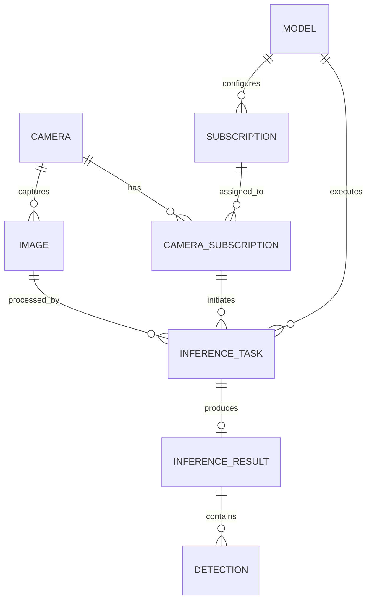

# VISP Software Architecture

## 1. Logical Architecture

VISP consists of six primary components with distinct responsibilities. The architecture separates camera acquisition, platform coordination, inference processing, asynchronous communication, and data storage.

### 1.1. Camera Acquisition

Maintains connections to registered network cameras and acquires video frames.

Responsibilities:
- Maintain connections to registered RTSP cameras.
- Monitor camera connectivity and acquisition status.
- Periodically retrieve camera and subscription configuration from the VISP Server.
- Acquire frames according to the configured acquisition interval.
- Submit acquired frames to the VISP Server for processing.
- Report component health and camera acquisition status through heartbeats.

Camera Acquisition does not determine which inference models or inference engines process a frame.

### 1.2. VISP Server

Coordinates platform operations, manages requests, and provides access to platform services.

Responsibilities:
- Expose interfaces for camera acquisition, applications, administrators, and external clients.
- Manage cameras, subscriptions, and application configurations.
- Receive and validate incoming frames and requests.
- Determine which subscriptions and inference models apply to acquired frames.
- Create and dispatch inference jobs through the Messaging System.
- Manage inference job lifecycles, including submission, completion, failure, and retries.
- Receive and process inference results.
- Coordinate the persistence of inference metadata and associated images.
- Manage component health and operational status.
- Provide access to historical inference data and associated images.

The VISP Server handles orchestration and management operations independently of the computational workload performed by Inference Engines.

### 1.3. Inference Engine

Executes computer vision models and returns inference results.

Responsibilities:
- Receive inference jobs through the Messaging System.
- Load and manage computer vision models.
- Execute inference using available compute resources, including GPU where available.
- Return inference results through the Messaging System.
- Report engine health and processing status.

Inference Engines are independent of the VISP Server and can be scaled separately. They execute inference jobs without needing to understand VISP subscriptions or application-specific business logic.

### 1.4. Messaging System

Facilitates asynchronous communication between the VISP Server and Inference Engines.

Responsibilities:
- Accept inference jobs submitted by the VISP Server.
- Make jobs available to compatible Inference Engines.
- Support asynchronous processing and decouple job submission from execution.
- Return inference results to the VISP Server.
- Retain jobs until an appropriate Inference Engine is available to process them.

The Messaging System transports jobs and results. Decisions about which processing tasks are required remain the responsibility of the VISP Server.

### 1.5. Database

Stores structured platform information and inference metadata.

Responsibilities:
- Store camera registrations and configuration.
- Store subscriptions and camera-subscription associations.
- Store application configurations and related platform metadata.
- Store inference job records and their status.
- Store inference results and detection metadata.
- Maintain current operational status of platform components and cameras.
- Optionally retain operational status history for diagnostics and monitoring.
- Store references to images and other files maintained by File Storage.

### 1.6. File Storage

Stores images and other files associated with inference results.

The initial implementation will use object storage through MinIO.

Responsibilities:
- Store images associated with inference results.
- Organize stored objects using identifiable object keys.
- Provide image retrieval through object references.
- Support image retention and deletion policies.
- Keep image storage independent of the Database.

The Database stores references to stored objects rather than the actual image data or temporary access URLs.

## 2. Component Interaction

### 2.1. Real-time Inference

1. Camera Acquisition periodically retrieves camera and subscription configuration from the VISP Server.
2. Camera Acquisition acquires a frame from a registered camera.
3. The frame is submitted to the VISP Server along with its camera identifier.
4. The VISP Server determines which subscriptions and inference models apply.
5. The VISP Server creates and submits the appropriate inference jobs to the Messaging System.
6. An available Inference Engine consumes the job and executes the required model.
7. The inference result is returned through the Messaging System.
8. The VISP Server processes the result and coordinates its storage and availability to applications.

A single acquired frame may generate multiple inference jobs when multiple subscriptions require different models or processing tasks.

### 2.2. VISP Query

1. A request is submitted to the VISP Server.
2. The VISP Server processes the request and retrieves the required information from the Database and/or File Storage.
3. The VISP Server returns the requested information to the requester.

### 2.3. Image Storage and Retrieval

1. The VISP Server submits an image to File Storage.
2. File Storage stores the image and returns an object reference.
3. The VISP Server stores the object reference and associated metadata in the Database.
4. When an image is requested, the VISP Server retrieves its reference from the Database.
5. The VISP Server uses that reference to retrieve the image from File Storage and makes it available to the requester.

## 3. Data Architecture

### 3.1. Data Organization

VISP data is organized into two logical domains based on the nature and lifecycle of the information they contain.

**Configuration and Registry Data**

This domain contains relatively stable entities that define the platform's registered resources and processing configurations.

- **Camera** – Represents a registered physical camera and its connection information.
- **Model** – Represents a registered computer vision model.
- **Subscription** – Defines how and when a computer vision model is used.
- **CameraSubscription** – Associates a Camera with a Subscription.

These entities may change throughout the platform's lifecycle, but generally represent longer-lived configuration information.

**Operational and Historical Data**

This domain contains chronological records generated during platform operation.

- **Image** – Represents an image acquired from a registered camera.
- **InferenceTask** – Represents a request to process an image using a particular camera subscription.
- **InferenceResult** – Represents the outcome returned from an inference task.
- **Detection** – Represents an individual object identified during inference.

Operational records are generated continuously and are expected to accumulate over time. They will therefore require independent retention, archival, backup and deletion policies.

These are logical data domains. Their separation does not necessarily imply separate databases or database servers.

### 3.2. Configuration and Registry Entities

#### 3.2.1. Camera

Represents a registered physical camera.

Proposed attributes:

- `camera_id` – Primary key.
- `camera_name` – Registered camera name.
- `rtsp_url` – Camera connection address.
- `location` – Physical installation location.
- `status` – Current camera status.

Additional camera configuration may include manufacturer, model, mounting position, orientation, field of view and calibration information.

Camera configuration can change throughout its lifecycle. Cameras should be decommissioned or disabled rather than physically deleted when historical records reference them.

#### 3.2.2. Model

Represents a registered computer vision model.

Proposed attributes:

- `model_id` – Primary key.
- `model_name` – Registered model name.
- `model_reference` – Reference to the model artifact.
- `model_type` – Model classification or task type.
- `version` – Model version.
- `status` – Current model status.

Models may be shared by multiple subscriptions. Model records should be retired or deactivated rather than physically deleted when historical inference tasks reference them.

#### 3.2.3. Subscription

Defines the processing configuration associated with a computer vision model.

Proposed attributes:

- `subscription_id` – Primary key.
- `subscription_name` – Subscription name.
- `model_id` – Foreign key referencing Model.
- `inference_schedule` – Defines when or how frequently inference is performed.
- `saving_policy` – Defines the image and inference data retention or saving behaviour associated with the subscription.
- `status` – Determines whether the processing configuration is available for use.

A Subscription is independent of a particular Camera. This allows the same processing configuration to be reused across multiple cameras.

Subscription records should be deactivated or retired rather than physically deleted when historical records reference them.

#### 3.2.4. CameraSubscription

Associates a Camera with a Subscription.

Proposed attributes:

- `camera_subscription_id` – Primary key.
- `camera_id` – Foreign key referencing Camera.
- `subscription_id` – Foreign key referencing Subscription.
- `status` – Current assignment status. Determines whether that particular camera is actively assigned to the subscription.

A Camera can have multiple subscriptions, and a Subscription can be assigned to multiple cameras.

The combination of `camera_id` and `subscription_id` must be unique.

CameraSubscription represents the specific assignment of a processing configuration to a camera. This relationship is important because an inference task must identify the particular camera-subscription assignment that initiated the processing request.

Assignments should be deactivated or ended rather than physically deleted when historical inference tasks reference them.

### 3.3. Operational and Historical Entities

#### 3.3.1. Image

Represents an image acquired from a registered camera.

Proposed attributes:

- `image_id` – Primary key.
- `image_reference` – Reference to the image stored in file storage (MinIO).
- `camera_id` – Foreign key referencing Camera.
- `camera_snapshot` – JSON snapshot of relevant camera metadata at the time of image capture.
- `captured_at` – Image capture timestamp.

The image is acquired once and can be referenced by multiple inference tasks.

For example, when a camera has multiple active subscriptions, the same acquired image may be processed independently by multiple models or processing configurations. Each resulting inference task references the same Image record.

The camera snapshot preserves historical context, including relevant information such as camera name, physical location, mounting position and orientation.

For cameras with dynamic positioning, such as PTZ cameras, the relevant position and orientation at capture time may also be included. More extensive camera movement history or telemetry can be introduced separately if required.

The Camera foreign key must use `ON DELETE RESTRICT` to prevent deletion of a camera while historical images reference it.

The Image database record and the physical image file are treated separately. The physical file may eventually be archived or deleted according to retention policies while the Image record remains available as historical metadata.

#### 3.3.2. InferenceTask

Represents an individual request to process an image using a particular CameraSubscription.

Proposed attributes:

- `task_id` – Primary key.
- `image_id` – Foreign key referencing Image.
- `camera_subscription_id` – Foreign key referencing CameraSubscription.
- `model_id` – Foreign key referencing Model.
- `subscription_snapshot` – JSON snapshot of the subscription configuration at task creation.
- `model_snapshot` – JSON snapshot of the model metadata at task creation.
- `status` – Current task lifecycle status.
- `submitted_at` – Task submission timestamp.
- `completed_at` – Task completion timestamp.
- `retry_count` – Number of processing attempts.

The task references the CameraSubscription that initiated processing and the Model used for inference.

Although the Model and Subscription are already referenced through the configuration relationships, snapshots are retained on the task to preserve the exact configuration context at the time of processing.

The model and subscription snapshots are captured when the task is created and must not be reconstructed from the current configuration records.

The Model foreign key is retained to support relational queries and maintain referential integrity. The model snapshot independently preserves historical metadata.

The CameraSubscription and Model foreign keys must use `ON DELETE RESTRICT` to prevent deletion of referenced configuration records. The Image foreign key must also protect historical task references.

#### 3.3.3. InferenceResult

Represents the outcome returned by an Inference Engine after processing an InferenceTask.

Proposed attributes:

- `result_id` – Primary key.
- `task_id` – Foreign key referencing InferenceTask.
- `status` – Inference outcome.
- `completed_at` – Inference completion timestamp.
- `processing_duration` – Time taken to execute inference.
- `detection_count` – Number of detections produced.
- `result_metadata` – Optional JSON containing additional inference execution information.

The result status is separate from the task status. Task status tracks the lifecycle of the processing request, while result status describes the outcome returned by the inference engine.

A successful inference can produce zero or more detections. An empty detection collection represents a valid inference result when no objects are identified.

The InferenceResult does not duplicate the model, subscription or camera snapshots. Its associated InferenceTask provides access to the relevant historical context.

An InferenceTask produces at most one final InferenceResult. The task and result records must be retained consistently so that historical results do not become detached from their originating tasks.

Retries, processing delays and other execution details may be recorded in result metadata or dedicated fields as their requirements become clearer.

#### 3.3.4. Detection

Represents an individual object identified during an inference operation.

Proposed attributes:

- `detection_id` – Primary key identifying the detection.
- `result_id` – Foreign key referencing InferenceResult.
- `class_id` – Model-defined class identifier.
- `class_name` – Human-readable object class.
- `confidence` – Confidence score assigned by the model.
- `bounding_box` – Coordinates describing the detected object's location in the image.

Each detection belongs to exactly one InferenceResult. An InferenceResult can have zero or many detections.

Detections are stored as individual database records rather than embedded in a JSON field. This allows detections to be queried independently by class, confidence, camera and time range.

`class_name` is stored alongside `class_id` so historical records remain understandable if a model's class definitions change.

Bounding-box coordinates should use normalized values between 0 and 1, making them independent of the original image resolution.

The image associated with a detection is resolved through its relationships:

`Detection → InferenceResult → InferenceTask → Image`

A separate `image_id` in the Detection table is unnecessary because the image can be determined through these relationships.

The `result_id` foreign key must use `ON DELETE RESTRICT` to protect detections associated with historical inference results.

### 3.4 Entity Relationships

#### 3.4.1 Entity Relationship Diagram

## 4. Deployment Architecture

To be defined.
